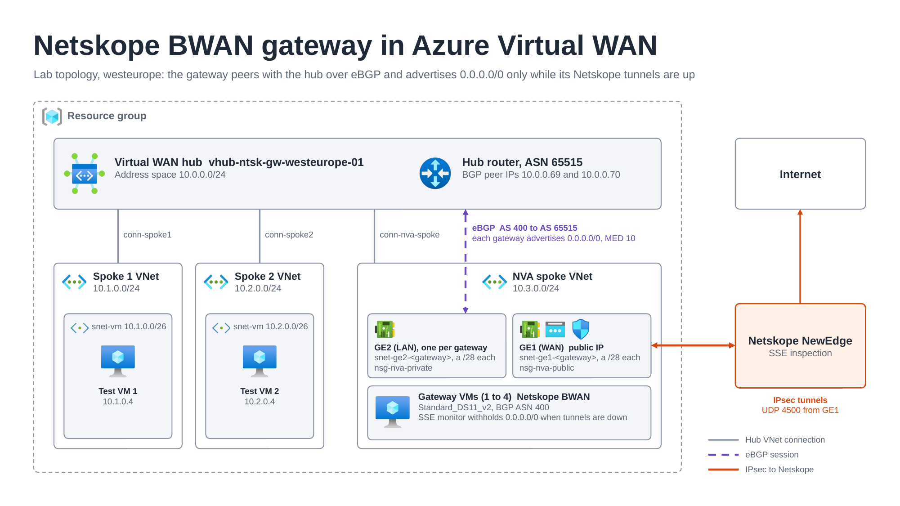

# Architecture

This document describes what the project builds, how the components connect, and the reasons for the design. The first half is for readers who need to understand the deployment. The second half (inventory, file map, BGP detail) is reference material.

## Overview

Azure **Virtual WAN** is Microsoft's managed hub-and-spoke network. You create a **virtual hub** in a region, and any VNet connected to it (a **spoke**) can automatically reach every other spoke through the hub. No peering or route tables need to be maintained. The hub contains a BGP router that Microsoft operates.

This project deploys a **Netskope SD-WAN gateway** in its own spoke and establishes a BGP session between the gateway and the hub router. Over this session the gateway learns the address ranges of the hub and the spokes, and advertises the default route to the hub, which indicates that the gateway can reach all destinations. The other side of the gateway is an IPsec tunnel to the Netskope cloud (NewEdge), so traffic that reaches the gateway is inspected by Netskope on its way to the internet.

One safety mechanism is the most important: the gateway advertises the default route only while its tunnels to Netskope are up. A monitoring script on the gateway (the **SSE monitor**) checks every 10 seconds and withdraws the route if the tunnels go down, so a gateway that has lost its connection to Netskope does not attract traffic it cannot forward.



```
                       Azure Virtual WAN
              ┌─────────────────────────────────────┐
              │  vhub  (10.0.0.0/24, ASN 65515)      │
              │  router IPs: 10.0.0.69, 10.0.0.70    │
              └──┬──────────┬──────────┬─────────────┘
       conn-spoke1│          │conn-spoke2│conn-nva-spoke
                  │          │          │
     ┌────────────▼─┐ ┌──────▼───────┐ ┌▼──────────────────────┐
     │ Spoke 1       │ │ Spoke 2      │ │ NVA Spoke              │
     │ 10.1.0.0/24   │ │ 10.2.0.0/24  │ │ 10.3.0.0/24            │
     │ test VM       │ │ test VM      │ │                        │
     └───────────────┘ └──────────────┘ │ vm-ntsk-gw-n           │
                                        │ GE1 (WAN) — public IP  │
                                        │ GE2 (LAN) — eBGP ──────┼──► vhub router IPs
                                        │ BGP ASN: 400           │
                                        └────────────┬───────────┘
                                                     │ IPsec / UDP 4500
                                                     ▼
                                            Netskope NewEdge
                                            (overlay peers:
                                             169.254.0.x)
```

### Deployment Phases

The deployment is split into two Terraform folders so that the slow, stable part and the fast, frequently rebuilt part are independent:

- **Phase 1 — `vwan-lab/`**: the Virtual WAN, the hub, and two small spoke VNets, each with an Ubuntu test VM. The test VMs are used to confirm that spoke-to-spoke routing works and to generate test traffic. This phase takes 15–30 minutes, almost all of which is spent on the hub.
- **Phase 2 — `vwan-lab-nva/`**: a third spoke containing the Netskope gateway(s), the BGP peering to the hub, the gateway's registration in the Netskope portal, and the two scripts that configure it after boot. This phase takes 10–15 minutes and can be destroyed and rebuilt without affecting Phase 1.

Phase 2 needs these values from Phase 1: the hub's ID, its two router IPs and the hub address range (plus the ASN, which is always 65515). The first two come from the Phase 1 output; the address range is the value set in the Phase 1 settings file. Copy them into the Phase 2 settings file.

### Gateway Interfaces

Each gateway VM has two network interfaces. The difference between them affects the whole design:

| | GE1 — WAN | GE2 — LAN |
|---|---|---|
| Azure subnet | `snet-ge1-<gateway>` (public) | `snet-ge2-<gateway>` (private) |
| Public IP | Yes | No |
| Security group | `nsg-nva-public`: SSH and UDP 4500 in, all out | `nsg-nva-private`: all in, all out |
| Used for | IPsec tunnels to Netskope; SSH management; the VM's default route | BGP to the hub router; traffic to/from the spokes |
| Netskope portal zone | untrusted, NAT on, overlay on | trusted, no overlay |

The WAN interface is listed first on the VM, so Azure makes it the default route. As a result, any traffic that is not specifically routed elsewhere goes out to the internet. Without further configuration, this would include BGP packets destined for the hub router. The configuration script therefore adds a route on the gateway that sends the hub's address range (`10.0.0.0/24`) out of the LAN interface instead. If that route is missing, the BGP session is not established. This is Step 3 of the [troubleshooting flowchart](TROUBLESHOOTING.md#step-3-is-the-hub-reachable-via-the-lan-interface).

## Traffic Flow

1. **BGP control plane**: gateway GE2 ↔ both hub router IPs. The gateway advertises `0.0.0.0/0` (MED 10) while tunnels are up and learns the hub and spoke ranges.
2. **Netskope overlay**: gateway GE1 (public IP) ↔ Netskope NewEdge POPs over IPsec/UDP 4500. Two overlay BGP peers (`169.254.0.x`) run over these tunnels; their state is the SSE monitor's health signal.
3. **Management**: operator → GE1 public IP (SSH), or Azure Run Command from the operator's machine (no open port required).
4. **Spoke to spoke**: Spoke 1 ↔ hub ↔ Spoke 2 — built-in Virtual WAN transit, no UDRs.
5. **Spoke to internet**: spoke VM → hub → gateway GE2 → IPsec tunnel → Netskope NewEdge → internet, while the gateway advertises the default route.

## Routing Behaviour

**Default route to the spokes**: the gateway advertises `0.0.0.0/0` to the hub over BGP, and the hub accepts it. The Phase 1 spoke connections are created with `internet_security_enabled = true`. With this setting the hub passes the default route it has learned to the spoke VNets, where it replaces the direct Azure internet route. Spoke internet traffic is then sent to the gateway and on to Netskope. Routing Intent is not required for this.

**Gateway spoke**: the gateway spoke connection (`conn-nva-spoke`) uses `internet_security_enabled = false`. The hub does not pass the default route to this connection, and the gateway's GE1 and GE2 network interfaces keep the direct Azure internet route for `0.0.0.0/0`.

**More than one gateway**: each gateway advertises the same default route with the same MED. The hub holds one `0.0.0.0/0` route per gateway (next hop type `HubBgpConnection`, AS path `400`) and balances traffic across them (ECMP). No static route is configured on the hub connection, because a static route accepts only one next hop.

**Tunnel failure**: the SSE monitor withholds the default route from a gateway whose tunnels are down. If no gateway advertises the route, the hub has no default route to pass on, and the spokes receive none from the hub.

| Setting | Where | Effect |
|---|---|---|
| `internet_security_enabled = true` | Spoke connections (`vwan-lab/spokes.tf`) | The hub passes its learned `0.0.0.0/0` to the spoke |
| `internet_security_enabled = false` | Gateway spoke connection (`vwan-lab-nva/nva_spoke.tf`) | The gateway spoke does not receive the default route from the hub |
| `azurerm_virtual_hub_bgp_connection` | One per gateway (`vwan-lab-nva/vhub_bgp.tf`) | The hub learns `0.0.0.0/0` from each gateway |

Verified on 2026-11-25 with two gateways (`docs/verification/`): both spoke connections listed `0.0.0.0/0` from each gateway's BGP connection, the spoke VM network interfaces showed `0.0.0.0/0` with next hop type `VirtualNetworkGateway`, the gateway spoke connection listed no default route, and spoke internet traffic left through Netskope addresses.

Background on hub BGP peering and its limits: [About BGP peering with a virtual hub](https://learn.microsoft.com/en-us/azure/virtual-wan/scenario-bgp-peering-hub).

## Address Plan

### Phase 1

| Network | CIDR | Purpose |
|---|---|---|
| Virtual hub | 10.0.0.0/24 | Reserved for the hub itself; the router IPs are allocated from here |
| Spoke 1 VNet / `snet-vm` | 10.1.0.0/24 / 10.1.0.0/26 | Test VM |
| Spoke 2 VNet / `snet-vm` | 10.2.0.0/24 / 10.2.0.0/26 | Test VM |

### Phase 2

The gateway spoke is `nva_spoke_address_space` (default `10.3.0.0/24`), and Terraform divides it automatically into `/28` subnets, two per gateway (WAN, then LAN):

| Subnet | CIDR | Purpose |
|---|---|---|
| `snet-ge1-ntsk-gw-1` | 10.3.0.0/28 | Gateway 1 WAN |
| `snet-ge2-ntsk-gw-1` | 10.3.0.16/28 | Gateway 1 LAN — its `.20` is the BGP peer IP; `.17` is the subnet gateway used for the hub route |
| `snet-ge1-ntsk-gw-2` | 10.3.0.32/28 | Gateway 2 WAN |
| `snet-ge2-ntsk-gw-2` | 10.3.0.48/28 | Gateway 2 LAN |

Virtual WAN does not connect a VNet whose range overlaps the hub or another connected VNet, so all of the ranges above must remain distinct.

## Security Layers

**Network security groups** — Phase 2:

| NSG | Direction | Rule | Purpose |
|---|---|---|---|
| `nsg-nva-public` (GE1) | Inbound | TCP/22 from `*` | SSH management — consider restricting the source |
| `nsg-nva-public` (GE1) | Inbound | UDP/4500 from `*` | IPsec NAT-T for the Netskope tunnels |
| `nsg-nva-public` (GE1) | Outbound | All | Tunnels and updates |
| `nsg-nva-private` (GE2) | Inbound / Outbound | All | Trusted side |

Phase 1 spoke NSGs allow SSH only from `ssh_source_address` and ICMP from within the virtual network. The test VMs have no public IP, so they are reached with Azure Run Command or from inside the virtual network.

**Public IPs** are Standard SKU, static and zone-redundant. The address is kept when the VM is moved between zones.

**Azure metadata protection**: after activation, the Netskope overlay uses `169.254.0.0/16`, which would also cover Azure's instance metadata address `169.254.169.254`. A `/32` route for that address is bound to the WAN interface, both by cloud-init on first boot and as a static route in the Netskope portal, so the Azure agent continues to work.

**Secrets**: the Netskope token, OS password and gateway password are passed to Terraform as environment variables and are never written to `terraform.tfvars`. They are, however, present in the Terraform state file and in the VM's cloud-init data. For this reason the state must be protected (see [State Management](STATE_MANAGEMENT.md)).

## Gateway Configuration

Creating the VM is only the first part of the deployment. Terraform then runs two scripts on the VM using Azure Run Command (a built-in Azure feature that runs a script on the VM without SSH):

1. **`null_resource.bgp_config`** activates the gateway against your Netskope tenant, writes the BGP configuration (hub peers, outbound filter), adds the LAN route to the hub, and restarts the gateway software. It waits for BGP neighbours to appear before finishing.
2. **`null_resource.sse_monitor`** copies the SSE monitor and its three FRR command files to `/infroot/sse_monitor/` and starts the monitor from a launcher container named `sse_monitor`. This location and the container both survive gateway upgrades.

Because these are scripts rather than Azure resources, Terraform re-runs them only when their inputs change or when you request it with `-replace`. This is explained in [Operations](OPERATIONS.md#using-terraform--replace). The mechanics are described in [DevOps Notes](DEVOPS_NOTES.md#azure-run-command-design).

## Reference: BGP Design

**Hub router**: ASN 65515 (fixed by Azure), two router IPs from the hub range. One `azurerm_virtual_hub_bgp_connection` per gateway registers the gateway's GE2 IP and ASN as a peer.

**Gateway (FRR inside the `infiot_spoke` container)**:

- ASN `gateway_bgp_asn` (default 400); peers with both hub IPs as `remote-as 65515`
- `ebgp-multihop 255` and `disable-connected-check`, because the hub IPs are not on the GE2 subnet
- Outbound route-map `set-med-peer`: permits only `0.0.0.0/0` (`match ip address prefix-list default`) and sets MED 10. The `match` condition prevents spoke prefixes learned from the hub from being advertised back to it. This bug was fixed on 2026-11-12 (see [CHANGELOG](../CHANGELOG.md)).
- **Default-route control**: the BGP configuration includes `route-map set-med-peer deny 5` (matching the default prefix), so the default route is withheld by default. The SSE monitor removes the rule while at least one tunnel is up and restores it when the tunnels are down. If the monitor is not running, the default route is not advertised. `default-originate` is not used.

**Host route**: `ip route replace <hub-prefix> via <GE2-subnet-gateway> dev <LAN-intf>`, in both the main table and policy table 101.

## Reference: Resource Inventory

### Phase 1 Azure resources

| Resource | Count | Notes |
|---|---|---|
| Resource group | 1 | Shared with Phase 2 |
| Virtual WAN | 1 | `Standard` (Basic does not support BGP peering and cannot be upgraded in place) |
| Virtual hub | 1 | 15–30 min to provision |
| Spoke VNets / subnets | 2 / 2 | `snet-vm` in each |
| Hub VNet connections | 2 | `internet_security_enabled = true` |
| NSGs / associations | 2 / 2 | SSH from `ssh_source_address`, ICMP from VirtualNetwork |
| NICs / VMs | 2 / 2 | Ubuntu 22.04 LTS Gen2, `Standard_B2s` |

### Phase 2 Azure resources (per deployment)

| Resource | Count | Notes |
|---|---|---|
| Virtual network | 1 | The gateway spoke |
| Subnets | 2 × gateway_count | GE1 + GE2 per gateway |
| Hub VNet connection | 1 | `conn-nva-spoke`, `internet_security_enabled = false`, no static route (see [DevOps Notes](DEVOPS_NOTES.md#hub-connection-static-route)) |
| Hub BGP connections | gateway_count | One per gateway, GE2 IP as peer |
| NSGs | 2 | `nsg-nva-public`, `nsg-nva-private` |
| NSG associations | 4 × gateway_count | Subnet-level and NIC-level per interface |
| Public IPs | gateway_count | GE1 only; Standard, static, zone-redundant |
| NICs | 2 × gateway_count | GE1 (primary) + GE2 (IP forwarding on) |
| VMs | gateway_count | Netskope Marketplace image, Premium_LRS OS disk, `plan {}` block required |
| Marketplace agreement | 0–1 | Only when `accept_plan = true` |
| `time_sleep` | 2 + gateway_count | API settle (30s), hub-connection delay (60s), per-gateway portal propagation (30s) |

### Phase 2 Netskope portal resources

| Resource | Count | Notes |
|---|---|---|
| Policy | 1 | Looked up by name; must already exist |
| Gateway | gateway_count | Model `iXVirtual`, role `gateway_role` |
| Gateway interface | 2 × gateway_count | GE1 (untrusted, NAT, overlay) + GE2 (trusted) |
| Static route | gateway_count | IMDS `169.254.169.254/32` via GE1 |
| BGP config | 2 × gateway_count | Two hub router IPs per gateway |
| Activation | gateway_count | Token consumed by cloud-init |

## Reference: File Map

### Phase 1 — `vwan-lab/`

| File | Purpose |
|---|---|
| `vwan.tf` | Resource group, Virtual WAN, virtual hub |
| `spokes.tf` | Spoke VNets, subnets, hub connections |
| `nsg.tf` | Per-spoke NSGs |
| `vm.tf` | NICs, test VMs (no public IPs) |
| `locals.tf` | `local.spokes` — names and CIDRs for both spokes |
| `outputs.tf` | Hub ID, router IPs/ASN (Phase 2 inputs), spoke and VM details |

### Phase 2 — `vwan-lab-nva/`

| File | Purpose |
|---|---|
| `locals.tf` | `local.nvas` map from `gateway_count`; subnet carving; interface and BGP-peer maps |
| `nva_spoke.tf` | Gateway spoke VNet, subnets, hub connection, 60s delay |
| `vhub_bgp.tf` | Hub BGP connection per gateway |
| `nsg.tf` | Public/private NSGs and subnet associations |
| `interfaces.tf` | GE1 public IPs, GE1/GE2 NICs, NIC-level NSG associations |
| `vm.tf` | Marketplace agreement, gateway VMs with cloud-init |
| `portal.tf` | Netskope portal: policy lookup, gateways, interfaces, IMDS route, BGP peers, activation |
| `run_command.tf` | The two post-boot scripts (`bgp_config`, `sse_monitor`) |
| `outputs.tf` | Names, IPs, connection IDs, ready-made verify commands |
| `provider.tf`, `variables.tf`, `versions.tf` | Providers, inputs, version pins |
| `scripts/user-data.sh` | Cloud-init: passwords, tenant URL, activation token, IMDS route |
| `scripts/azure_run_command.sh` | Helper that waits for the VM and runs a script on it |
| `scripts/sse_monitor.sh` | The SSE monitor (deployed to `/infroot/sse_monitor/`, started by the `sse_monitor` launcher container) |

## Provider Versions

| Provider | Source | Version | Purpose |
|---|---|---|---|
| `azurerm` | hashicorp/azurerm | ~> 3.0 | Azure infrastructure |
| `netskopebwan` | netskopeoss/netskopebwan | 0.0.2 | Netskope portal configuration (Phase 2) |
| `null` | hashicorp/null | ~> 3.0 | The post-boot scripts (Phase 2) |
| `time` | hashicorp/time | ~> 0.7 | Deliberate waits (Phase 2) |
| Terraform | — | >= 1.3 | Core |
